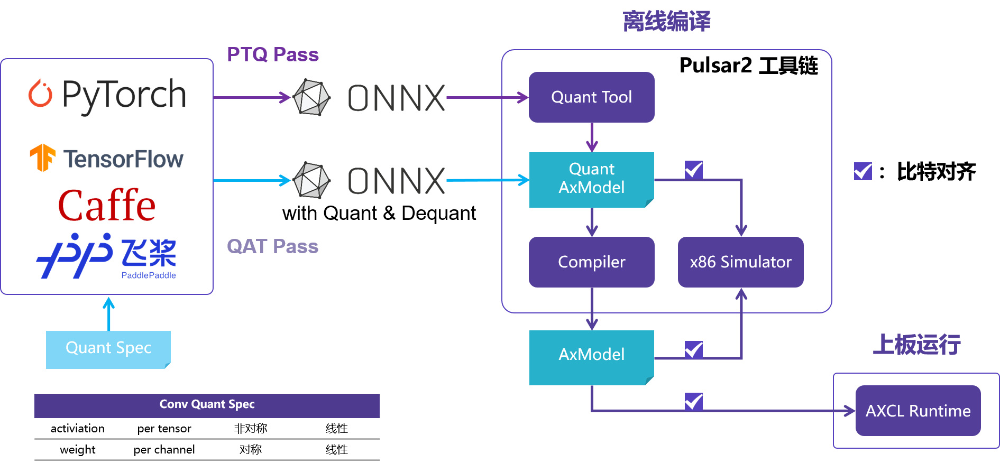
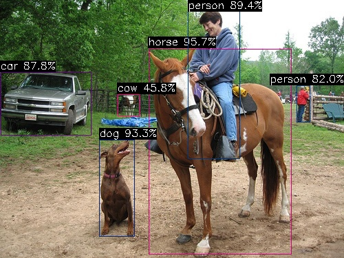
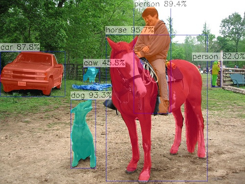
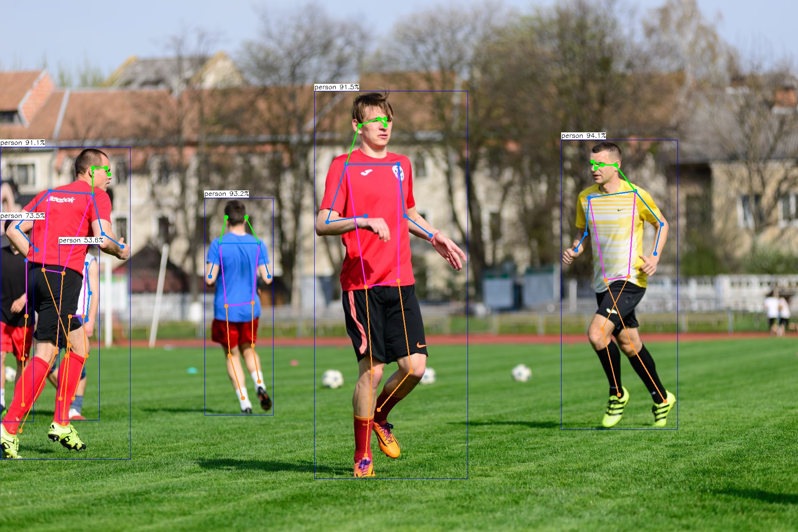
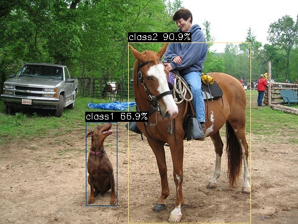
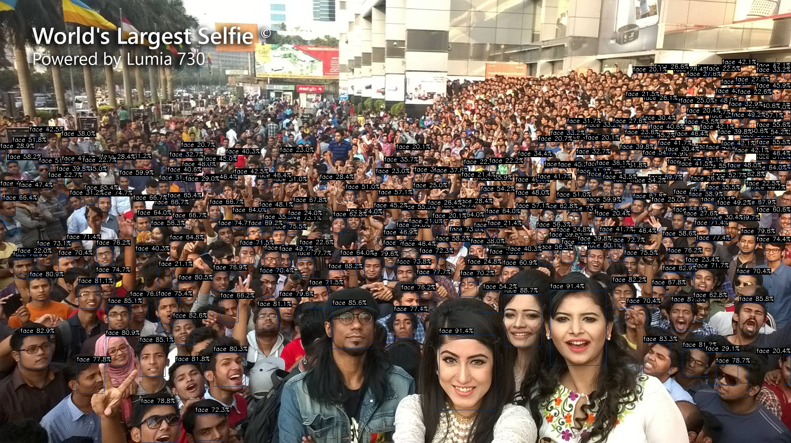

# NPU 示例

## NPU 工具链

经常在 AI 芯片上部署算法模型的同学都知道，想要把模型部署到芯片上的 NPU 中运行，都需要使用芯片原厂提供的 NPU 工具链，这里我们使用的是 Pulsar2。



- [Pulsar2 在线文档](https://pulsar2-docs.readthedocs.io/zh-cn/latest/index.html)
  - [安装指导](https://pulsar2-docs.readthedocs.io/zh-cn/latest/user_guides_quick/quick_start_prepare.html)
  - [快速上手](https://pulsar2-docs.readthedocs.io/zh-cn/latest/user_guides_quick/quick_start_ax650.html)
  - [NPU 算子支持列表](https://pulsar2-docs.readthedocs.io/zh-cn/latest/appendix/op_support_list_ax650.html)
  - [大模型转换](https://pulsar2-docs.readthedocs.io/zh-cn/latest/appendix/build_llm.html)

## AXCL-Samples

AXCL-Samples 由 爱芯元智 主导开发。该项目实现了常见的深度学习开源算法在基于 爱芯元智 的 SoC 实现的 PCIE算力卡 产品上的运行的示例代码，方便社区开发者进行快速评估和适配。

- [axcl-samples](https://github.com/AXERA-TECH/axcl-samples)；
- 该仓库采用最简单的方式展示常用的开源模型，例如 Ultralytics 的 YOLO 系列，DepthAnything，YOLO-Worldv2 等等。

### 获取示例

- AXCL-Samples 的预编译 ModelZoo 请参考
  - [百度网盘](https://pan.baidu.com/s/1MAAKElTI2wgiDehvd2Q1lA?pwd=p1k6)

### YOLO11x

基于 Ultralytics YOLO11 系列模型详细的模型导出、量化、编译的流程请参考[《基于 AX650N 部署 YOLO11》](https://zhuanlan.zhihu.com/p/772269394)

```
(base) axera@raspberrypi:~/temp $ ./axcl_yolo11 -i ssd_horse.jpg -m yolo11x.axmodel
--------------------------------------
model file : yolo11x.axmodel
image file : ssd_horse.jpg
img_h, img_w : 640 640
--------------------------------------
post process cost time:1.44 ms
--------------------------------------
Repeat 1 times, avg time 24.69 ms, max_time 24.69 ms, min_time 24.69 ms
--------------------------------------
detection num: 6
17:  96%, [ 216,   71,  423,  370], horse
16:  93%, [ 144,  203,  196,  345], dog
 0:  89%, [ 273,   14,  349,  231], person
 2:  88%, [   1,  105,  132,  197], car
 0:  82%, [ 431,  124,  451,  178], person
19:  46%, [ 171,  137,  202,  169], cow
--------------------------------------
```


### YOLO11x-Seg

```
(base) axera@raspberrypi:~/temp $ ./axcl_yolo11_seg -i ssd_horse.jpg -m yolo11x-seg.axmodel
--------------------------------------
model file : yolo11x-seg.axmodel
image file : ssd_horse.jpg
img_h, img_w : 640 640
--------------------------------------
post process cost time:3.12 ms
--------------------------------------
Repeat 1 times, avg time 34.75 ms, max_time 34.75 ms, min_time 34.75 ms
--------------------------------------
detection num: 6
17:  96%, [ 216,   71,  423,  370], horse
16:  93%, [ 144,  203,  196,  345], dog
 0:  89%, [ 273,   14,  349,  231], person
 2:  88%, [   1,  105,  132,  197], car
 0:  82%, [ 431,  124,  451,  178], person
19:  46%, [ 171,  137,  202,  169], cow
--------------------------------------
```


### YOLO11x-Pose

```
axera@raspberrypi:~/temp $ ./axcl_yolo11_pose -i football.jpg -m yolo11x-pose.axmodel
--------------------------------------
model file : yolo11x-pose.axmodel
image file : football.jpg
img_h, img_w : 640 640
--------------------------------------
post process cost time:0.59 ms
--------------------------------------
Repeat 1 times, avg time 25.02 ms, max_time 25.02 ms, min_time 25.02 ms
--------------------------------------
detection num: 6
 0:  94%, [1350,  337, 1632, 1036], person
 0:  93%, [ 492,  477,  658, 1000], person
 0:  92%, [ 756,  219, 1126, 1154], person
 0:  91%, [   0,  354,  314, 1108], person
 0:  73%, [   0,  530,   81, 1017], person
 0:  54%, [ 142,  589,  239, 1013], person
--------------------------------------
```


### YOLO World v2

YOLO-Worldv2 该模型的详细模型导出、量化、编译的流程请参考[《再谈 YOLO World 部署》](https://zhuanlan.zhihu.com/p/721856217)

- 模型：yoloworldv2_4cls_50_npu3.axmodel
- 输入图片：ssd_horse.jpg
- 输入文本：dog.bin, 对应的 4 分类 'dog' 'horse' 'sheep' 'cow'

```
axera@raspberrypi:~/temp $ ./axcl_yolo_world_open_vocabulary -m yoloworldv2_4cls_50_npu3.axmodel -t dog.bin -i ssd_horse.jpg
--------------------------------------
model file : yoloworldv2_4cls_50_npu3.axmodel
image file : ssd_horse.jpg
text_feature file : dog.bin
img_h, img_w : 640 640
--------------------------------------
post process cost time:0.35 ms
--------------------------------------
Repeat 1 times, avg time 4.47 ms, max_time 4.47 ms, min_time 4.47 ms
--------------------------------------
detection num: 2
 1:  91%, [ 215,   71,  421,  374], class2
 0:  67%, [ 144,  204,  197,  346], class1
--------------------------------------
```


### YOLOv7-Face

```
axera@raspberrypi:~/temp $ ./axcl_yolov7_face -m yolov7-face.axmodel -i selfie.jpg
--------------------------------------
model file : yolov7-face.axmodel
image file : selfie.jpg
img_h, img_w : 640 640
--------------------------------------
post process cost time:8.28 ms
--------------------------------------
Repeat 1 times, avg time 12.17 ms, max_time 12.17 ms, min_time 12.17 ms
--------------------------------------
detection num: 277
 0:  91%, [1137,  869, 1283, 1065], face
 0:  91%, [1424,  753, 1570,  949], face
......
 0:  20%, [1120,  570, 1145,  604], face
 0:  20%, [1025,  390, 1041,  413], face
```


### DepthAnything

DepthAnything 该模型的详细模型导出、量化、编译的流程请参考[《基于 AX650N 的 Depth Anything》](https://zhuanlan.zhihu.com/p/681378259)

```
axera@raspberrypi:~/temp/axcl-samples/build $ ./install/bin/ax_depth_anything -m depth_anything.axmodel -i ssd_horse.jpg
--------------------------------------
model file : depth_anything.axmodel
image file : ssd_horse.jpg
img_h, img_w : 384 640
--------------------------------------
post process cost time:4.43 ms
--------------------------------------
Repeat 1 times, avg time 44.02 ms, max_time 44.02 ms, min_time 44.02 ms
--------------------------------------
```


## LLM 示例

- 模型转换请参考[大模型编译文档](https://pulsar2-docs.readthedocs.io/zh-cn/latest/appendix/build_llm.html)
- 预编译 ModelZoo-LLM 请参考[百度网盘](https://pan.baidu.com/s/1grJNjcpUln-fDBisJxuvCA?pwd=mys8)
- 上板执行程序 main_pcie 请参考[ax-llm pcie 分支](https://github.com/AXERA-TECH/ax-llm/tree/axcl-llm-prefill)

### Tokenizer 解析器

**tokenizer 解析准备**

为了更方便、更准确的进行 LLM DEMO 展示，我们采用 transformers 内置的 tokenizer 解析服务，因此需要安装 python 环境和 transformers 库

安装 miniconda

```
wget https://repo.anaconda.com/miniconda/Miniconda3-latest-Linux-aarch64.sh
chmod a+x Miniconda3-latest-Linux-aarch64.sh
./Miniconda3-latest-Linux-aarch64.sh
```

启用 python 环境

```
conda create --name axcl python=3.9
conda activate axcl
```

安装 transformers

```
pip install transformers==4.41.1 -i https://mirrors.aliyun.com/pypi/simple
```

### Qwen3-0.6B

拷贝相关文件到 Host

**文件说明**

```
(base) axera@raspberrypi:~/Qwen3-0.6B $ tree -L 1
.
├── config.json
├── main_api_ax650
├── main_api_axcl_aarch64
├── main_api_axcl_x86
├── main_ax650
├── main_axcl_aarch64
├── main_axcl_x86
├── post_config.json
├── qwen2.5_tokenizer
├── qwen3-0.6b-ax630c
├── qwen3-0.6b-ax650
├── qwen3_tokenizer
├── qwen3_tokenizer_uid.py
├── README.md
├── run_qwen3_0.6b_int8_ctx_ax630c.sh
├── run_qwen3_0.6b_int8_ctx_ax650.sh
├── run_qwen3_0.6b_int8_ctx_axcl_aarch64.sh
└── run_qwen3_0.6b_int8_ctx_axcl_x86.sh

5 directories, 14 files
```

**启动 tokenizer 解析器**

运行 tokenizer 服务，Host ip 默认为 localhost，端口号设置为 12345，正在运行后信息如下

```
(axcl) axera@raspberrypi:~/qwen2.5-0.5b-prefill-ax650 $ python qwen3_tokenizer_uid.py --port 12345
Server running at http://0.0.0.0:12345
```

**运行 Qwen 3-0.6B**

```
(base) axera@raspberrypi:~/qtang/llama_axera_cpp $ ./run_qwen3_0.6b_int8_ctx_axcl_aarch64.sh
[I][                            Init][ 130]: LLM init start
[I][                            Init][  34]: connect http://0.0.0.0:12345 ok
[I][                            Init][  57]: uid: 009101db-7dc2-4097-bdf3-c9124923792f
bos_id: -1, eos_id: 151645
  3% | ██                                |   1 /  31 [0.80s<24.89s, 1.25 count/s] tokenizer init ok[I][                            Init][  45]: LLaMaEmbedSelector use mmap
  6% | ███                               |   2 /  31 [0.80s<12.45s, 2.49 count/s] embed_selector init ok
[I][                             run][  30]: AXCLWorker start with devid 0
100% | ████████████████████████████████ |  31 /  31 [28.87s<28.87s, 1.07 count/s] init post axmodel ok,remain_cmm(5789 MB)5951 MB)
[I][                            Init][ 221]: max_token_len : 2047
[I][                            Init][ 224]: kv_cache_size : 1024, kv_cache_num: 2047
[I][                            Init][ 232]: prefill_token_num : 128
[I][                            Init][ 236]: grp: 1, prefill_max_token_num : 1
[I][                            Init][ 236]: grp: 2, prefill_max_token_num : 128
[I][                            Init][ 236]: grp: 3, prefill_max_token_num : 256
[I][                            Init][ 236]: grp: 4, prefill_max_token_num : 384
[I][                            Init][ 236]: grp: 5, prefill_max_token_num : 512
[I][                            Init][ 236]: grp: 6, prefill_max_token_num : 640
[I][                            Init][ 236]: grp: 7, prefill_max_token_num : 768
[I][                            Init][ 236]: grp: 8, prefill_max_token_num : 896
[I][                            Init][ 236]: grp: 9, prefill_max_token_num : 1024
[I][                            Init][ 240]: prefill_max_token_num : 1024
________________________
|    ID| remain cmm(MB)|
========================
|     0|           5789|
¯¯¯¯¯¯¯¯¯¯¯¯¯¯¯¯¯¯¯¯¯¯¯¯
[I][                     load_config][ 282]: load config:
{
    "enable_repetition_penalty": false,
    "enable_temperature": false,
    "enable_top_k_sampling": true,
    "enable_top_p_sampling": false,
    "penalty_window": 20,
    "repetition_penalty": 1.2,
    "temperature": 0.9,
    "top_k": 1,
    "top_p": 0.8
}

[I][                            Init][ 263]: LLM init ok
Type "q" to exit, Ctrl+c to stop current running
[I][          GenerateKVCachePrefill][ 324]: input token num : 21, prefill_split_num : 1 prefill_grpid : 2
[I][          GenerateKVCachePrefill][ 367]: input_num_token:21
[I][                            main][ 234]: precompute_len: 21
[I][                            main][ 235]: system_prompt: You are Qwen, created by Alibaba Cloud. You are a helpful assistant.
prompt >> 你是谁
[I][                      SetKVCache][ 614]: prefill_grpid:2 kv_cache_num:128 precompute_len:21 input_num_token:13
[I][                      SetKVCache][ 617]: current prefill_max_token_num:896
[I][                             Run][ 752]: input token num : 13, prefill_split_num : 1
[I][                             Run][ 784]: input_num_token:13
[I][                             Run][ 913]: ttft: 369.81 ms
<think>

</think>

我是Qwen，由阿里巴巴云创建的AI助手。我致力于提供帮助和支持，帮助用户解决问题和获取信息。如果您有任何问题或需要帮助，请随时告诉我！

[N][                             Run][1065]: hit eos,avg 12.41 token/s

[I][                      GetKVCache][ 583]: precompute_len:73, remaining:951
prompt >> 深圳在哪里
[I][                      SetKVCache][ 614]: prefill_grpid:2 kv_cache_num:128 precompute_len:73 input_num_token:13
[I][                      SetKVCache][ 617]: current prefill_max_token_num:896
[I][                             Run][ 752]: input token num : 13, prefill_split_num : 1
[I][                             Run][ 784]: input_num_token:13
[I][                             Run][ 913]: ttft: 365.79 ms
<think>

</think>

深圳是中国广东省的一个城市，位于中国东南部沿海地区。如果您有其他问题或需要帮助，请随时告诉我！

[N][                             Run][1065]: hit eos,avg 12.55 token/s

[I][                      GetKVCache][ 583]: precompute_len:114, remaining:910
prompt >> q
[I][                             run][  80]: AXCLWorker exit with devid 0
```

## VLM 示例
### Qwen3-VL-2B-Instruct-GPTQ-Int4

Qwen3-VL-2B-Instruct-GPTQ-Int4 的详细模型导出、量化、编译的流程请参考[《Model Convert》](https://github.com/AXERA-TECH/Qwen3-VL.AXERA/tree/main/model_convert)

拷贝相关文件到 Host

**文件说明**

```
(axcl) axera@raspberrypi:~/iwen3-VL-2B-Instruct-GPTQ-Int4 $ tree -L 1
.
├── axera_logo.png
├── config.json
├── gradio_demo.py
├── images
├── main_ax650
├── main_ax650_api
├── main_axcl_aarch64
├── main_axcl_api_aarch64
├── main_axcl_api_x86
├── main_axcl_x86
├── openai_cli.py
├── post_config.json
├── qwen3_tokenizer.txt
├── Qwen3-VL-2B-Instruct-AX650-c128_p1152-int4
├── README.md
├── requirements.txt
├── run_ax650_api.sh
├── run_axcl_aarch64_api.sh
├── run_axcl_x86_api.sh
├── run_image_ax630c.sh
├── run_image_ax650_img640.sh
├── run_image_ax650_img720p.sh
├── run_image_ax650_imgu8.sh
├── run_image_ax650.sh
├── run_image_axcl_aarch64.sh
├── run_image_axcl_x86.sh
├── run_video_ax650_imgu8.sh
├── run_video_ax650.sh
├── run_video_axcl_aarch64.sh
├── run_video_axcl_x86.sh
└── video

4 directories, 28 files
```

**运行 Qwen3-VL-2B-Instruct-GPTQ-Int4**

测试图片


输出信息

```
(base) axera@raspberrypi:~/Qwen3-VL-2B-Instruct-GPTQ-Int4 $ chmod +x main* run*
(base) axera@raspberrypi:~/Qwen3-VL-2B-Instruct-GPTQ-Int4 $ ./run_image_axcl_aarch64.sh
[I][                            Init][ 162]: LLM init start
tokenizer_type = 1
  3% | ██                                |   1 /  31 [0.03s<0.87s, 35.71 count/s] tokenizer init ok[I][                            Init][  45]: LLaMaEmbedSelector use mmap
  6% | ███                               |   2 /  31 [0.03s<0.43s, 71.43 count/s] embed_selector init ok
[I][                             run][  30]: AXCLWorker start with devid 0
100% | ████████████████████████████████ |  31 /  31 [30.98s<30.98s, 1.00 count/s] init post axmodel ok,remain_cmm(4220 MB)544 MB))
input size: 1
    name: hidden_states [unknown] [unknown]
        1 x 576 x 512 x 3 size:884736


output size: 4
    name: hidden_states_out
        144 x 2048 size:1179648

    name: deepstack_feature_0
        144 x 2048 size:1179648

    name: deepstack_feature_1
        144 x 2048 size:1179648

    name: deepstack_feature_2
        144 x 2048 size:1179648

[I][                            Init][ 329]: image encoder output float32

[I][                            Init][ 341]: max_token_len : 2047
[I][                            Init][ 344]: kv_cache_size : 1024, kv_cache_num: 2047
[I][                            Init][ 352]: prefill_token_num : 128
[I][                            Init][ 356]: grp: 1, prefill_max_token_num : 1
[I][                            Init][ 356]: grp: 2, prefill_max_token_num : 128
[I][                            Init][ 356]: grp: 3, prefill_max_token_num : 256
[I][                            Init][ 356]: grp: 4, prefill_max_token_num : 384
[I][                            Init][ 356]: grp: 5, prefill_max_token_num : 512
[I][                            Init][ 356]: grp: 6, prefill_max_token_num : 640
[I][                            Init][ 356]: grp: 7, prefill_max_token_num : 768
[I][                            Init][ 356]: grp: 8, prefill_max_token_num : 896
[I][                            Init][ 356]: grp: 9, prefill_max_token_num : 1024
[I][                            Init][ 356]: grp: 10, prefill_max_token_num : 1152
[I][                            Init][ 360]: prefill_max_token_num : 1152
________________________
|    ID| remain cmm(MB)|
========================
|     0|           3778|
¯¯¯¯¯¯¯¯¯¯¯¯¯¯¯¯¯¯¯¯¯¯¯¯
[I][                     load_config][ 282]: load config:
{
    "enable_repetition_penalty": false,
    "enable_temperature": true,
    "enable_top_k_sampling": true,
    "enable_top_p_sampling": false,
    "penalty_window": 30,
    "repetition_penalty": 1,
    "temperature": 0.7,
    "top_k": 20,
    "top_p": 0.8
}

[I][                            Init][ 457]: LLM init ok
Type "q" to exit, Ctrl+c to stop current running
prompt >> 你是谁
image >>
[I][                             Run][ 709]: input token num : 21, prefill_split_num : 1
[I][                             Run][ 743]: input_num_token:21
[I][                             Run][ 922]: ttft: 279.87 ms
您好！我是Qwen，是阿里巴巴集团研发的超大规模语言模型。我能够像人类一样进行对话和回答问题，擅长理解语言并进行创造性表达。无论是回答问题、写故事，还是进行逻辑推理、编程、写作、翻译，我都能提供帮助。有什么我可以帮您的吗？

[N][                             Run][1075]: hit eos,avg 9.65 token/s

prompt >> 图片里有什么
image >> ./images/ssd_car.jpg
[I][                     EncodeImage][ 531]: pixel_values size 1
[I][                     EncodeImage][ 532]: grid_h 24 grid_w 24
[I][                     EncodeImage][ 580]: image encode time : 182.535995 ms, size : 1
[I][                          Encode][ 633]: input_ids size:168
[I][                          Encode][ 641]: offset 15
[I][                          Encode][ 670]: img_embed.size:1, 294912
[I][                          Encode][ 684]: out_embed size:344064
[I][                          Encode][ 685]: input_ids size 168
[I][                          Encode][ 687]: position_ids size:168
[I][                             Run][ 709]: input token num : 168, prefill_split_num : 2
[I][                             Run][ 743]: input_num_token:128
[I][                             Run][ 743]: input_num_token:40
[I][                             Run][ 922]: ttft: 561.53 ms
好的，这张图片展示了一个城市街景。以下是图片中的具体内容：

- **红色的双层巴士**：图片中心偏左位置是一辆红色的双层巴士，这是伦敦著名的“红色双层巴士”（Red Bus），它在城市中非常常见。这辆巴士是典型的伦敦巴士样式，车头有大灯，车身有条纹装饰，车身上有文字“CITY BUS”。
- **人物**：在巴士前方的街道上，站着一位女性。她穿着深色的外套，可能是一位女士，她正看着前方。
- **建筑物**：在巴士的后方和两侧，是几栋多层的建筑，这可能是伦敦的市中心，这些建筑具有典型的英国建筑风格，例如有阳台和装饰性的窗户。

此外，还可以看到一些细节：
- 一些建筑物上可以看到“LONDON”字样，这可能是在表明这是在伦敦的某个地方。
- 街道上有路灯，街道两旁有树木。

---

### 分析总结

这张图片展示的是一个典型的伦敦城市街景。红色的双层巴士是该地区非常具有代表性的标志，而周围是典型的城市建筑，这可能是在伦敦市中心的某个地方，比如伦敦市中心的市中心地区，例如威斯敏斯特区或伦敦市中心的某个地方。

因此，这张图片描绘的是一个典型的伦敦城市街景，其中红色的双层巴士和周围的建筑是主要的视觉元素。

---

### 简要回答

这张图片展示的是一个位于英国伦敦市中心的街景，主要元素包括一辆红色的双层巴士和周围的建筑。

[N][                             Run][1075]: hit eos,avg 9.69 token/s

prompt >> q
[I][                             run][  80]: AXCLWorker exit with devid 0
```

## 音频大模型

本章节展示常用的 ASR（自动语音识别）、TTS（文本转语音）模型示例。

### SenseVoice

- 本小节只指导如何在 Raspberry Pi 5 上运行预编译好的基于 SenseVoice 的语音转文字示例；
- 示例源码编译请参考 [ax_asr_api](https://github.com/AXERA-TECH/ax_asr_api/tree/main)。
- 预编译文件和模型请参考[AXERA-TECH/SenseVoice](https://huggingface.co/AXERA-TECH/SenseVoice/tree/main)。

**下载**
```
git clone https://github.com/AXERA-TECH/ax_asr_api.git
```
**编译**
参考[ax_asr_api](https://github.com/AXERA-TECH/ax_asr_api/tree/main)的README.md进行交叉编译。

**模型仓库下载**
```
hf download AXERA-TECH/SenseVoice --local-dir SenseVoice
```

**运行 SenseVoice**

```
cd SenseVoice/cpp/axcl_aarch64/
export LD_LIBRARY_PATH=.:$LD_LIBRARY_PATH
./main -a ../../example/zh.mp3 -t sensevoice -p ../../sensevoice_ax650 -l zh
```

**运行结果**

```
(sensevoice) axera@raspberrypi:~/SenseVoice/cpp/axcl_aarch64 $ ./main -a ../../example/zh.mp3 -t sensevoice -p ../../sensevoice_ax650 -l zh
Init asr: sensevoice success, take 4.0690seconds
Result: 开放时间早上9点至下午5点。
RTF(0.19 / 5.62) = 0.0329
(sensevoice) axera@raspberrypi:~/SenseVoice/cpp/axcl_aarch64 $
```

### Kokoro

- 本小节只指导如何在 Raspberry Pi 5 上运行预编译好的Kokoro 文字转语音示例；
- 示例源码编译请参考 [ax_tts_api](https://github.com/AXERA-TECH/ax_tts_api/tree/main)。
- 预编译模型请参考 [Kokoro](https://huggingface.co/AXERA-TECH/kokoro.axera)

**下载**

```
git clone https://github.com/AXERA-TECH/ax_tts_api.git
```

**下载预编译模型**

```
cd ax_tts_api
chmod +x download_models.sh
./download_models.sh
```

**编译**

参考[ax_tts_api](https://github.com/AXERA-TECH/ax_tts_api/tree/main)的README.md进行交叉编译。

**运行结果**
将预编译模型文件夹和预编译执行文件夹拷贝到板端，当前以axcl_aarch64为例：

```
(base) axera@raspberrypi:~/ax_tts_api $ ./build_ax8850_aarch64/main -l zh -t "一切有为法，如梦幻泡影，如露亦如电，应作如是观" -o zh.wav
================================
test_zh:
input text: 一切有为法，如梦幻泡影，如露亦如电，应作如是观
output duration: 4.18 seconds
output file: zh.wav
```
