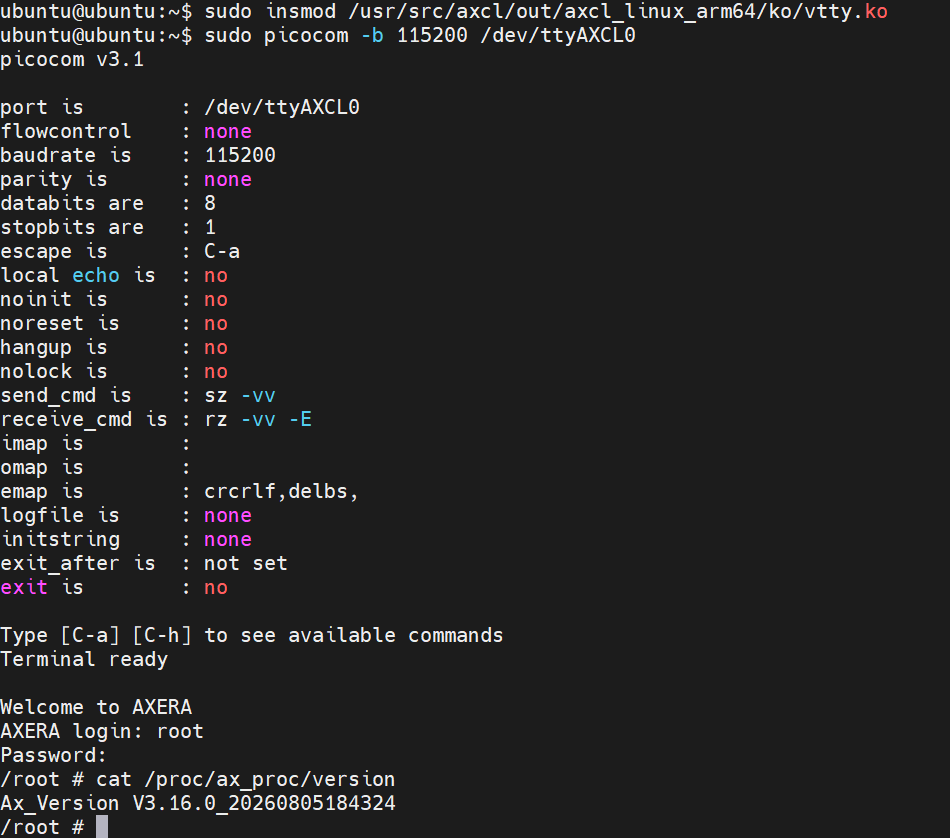

# vtty 使用说明

**注意**：3.16.0以前的版本不支持vtty功能。

vtty 是 AXCL PCIe 虚拟串口驱动，用于在 Host 与 AX650 子卡之间建立一个 TTY 通道。Host 侧加载后会生成 `/dev/ttyAXCL0`、`/dev/ttyAXCL1` 等设备节点，可通过串口终端工具登录子卡系统或传输少量文本数据。

## 使用场景

- 不方便连接实体串口时，通过 PCIe 访问子卡 shell，作为调试入口查看日志、执行命令。。
- 多卡环境下，Host 侧每个可连接的子卡对应一个 `/dev/ttyAXCLx` 节点。

## 前置条件

Host 侧 Axclhost 工具包已安装完成并成功识别到子卡。

子卡侧系统启动时默认脚本会加载 `vtty.ko`，在使用vtty前可以在主控系统通过 `axcl-smi sh "ls /dev/ttyAXCL*"` 检查子卡是否已经成功加载vtty驱动。

## Host 侧加载 vtty

先确认 Host 侧基础驱动已加载：

```bash
lsmod | grep -E "ax_pcie_host_dev|ax_pcie_msg|ax_pcie_mmb|axcl_host"
```

通过如下命令安装vtty驱动，默认情况下，`vtty` 会枚举所有可连接的子卡并生成多个 TTY 节点。：

```bash
sudo insmod /usr/src/axcl/out/axcl_linux_arm64/ko/vtty.ko
```

加载成功后可在主控端查看设备节点：

```bash
ls -l /dev/ttyAXCL*
```

如果系统中没有安装 `vtty.ko`，可从 SDK 编译输出目录取出并加载，例如 x86 Host：

```bash
cd axcl/drv/pcie/driver
make host=x86 clean all install
sudo cp ../../out/axcl_linux_x86/ko/vtty.ko /lib/modules/$(uname -r)/extra/
sudo depmod -a
sudo modprobe vtty
```

其他 Host 架构对应输出目录请查看 [SDK 编译](#sdk_compile) 对应内容。

## 连接子卡 shell

安装串口终端工具：

```bash
sudo apt install -y picocom
```

连接 `/dev/ttyAXCL0`：

```bash
sudo picocom -b 115200 /dev/ttyAXCL0
```

vtty 连接效果如下：



也可以使用 `minicom`、`screen` 等工具：

```bash
sudo screen /dev/ttyAXCL0 115200
```

连接后按回车，如果子卡侧 `getty` 正常，会进入登录或 shell 提示符，用户名：root；密码：123456。

退出方式：

- `picocom`：按 `Ctrl + A`，再按 `Ctrl + X`。
- `screen`：按 `Ctrl + A`，再按 `K`，确认退出。

## 卸载 vtty

先退出正在使用 `/dev/ttyAXCLx` 的终端程序，再卸载模块：

```bash
sudo rmmod /usr/src/axcl/out/axcl_linux_arm64/ko/vtty.ko
```

如提示 busy，先查看占用进程：

```bash
sudo lsof /dev/ttyAXCL0
```

结束对应进程后再卸载。

## 常见问题

### 找不到 /dev/ttyAXCL0

检查顺序：

```bash
lsmod | grep vtty
dmesg | grep vtty
axcl-smi
```

一般原因：

- Host 侧没有加载 `vtty.ko`。
- Host 侧基础 PCIe 驱动未正常加载。
- 子卡未上电或未被 Host 识别。
- 子卡侧没有加载 `vtty.ko`。
- 多卡环境下生成的是 `/dev/ttyAXCL1`、`/dev/ttyAXCL2` 等节点。

### modprobe vtty 失败

查看内核日志：

```bash
dmesg | tail -n 50
```

常见原因：

- `vtty.ko` 没有安装到 `/lib/modules/$(uname -r)/extra/`。
- `ax_pcie_msg` 等依赖模块未加载。
- `port=80` 已被其他 MSG 通道占用，可更换端口后再加载。

